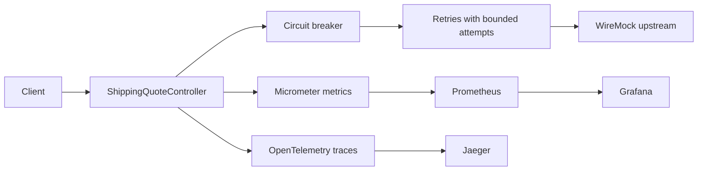

# Resilience + Observability | Production-minded Spring API

**Java 21 · Spring Boot · Resilience4j · Micrometer · Prometheus · OpenTelemetry · Jaeger · Grafana**

An HTTP service dependent on another HTTP service that **sometimes fails**. Demonstrates graceful degradation, retry and circuit-breaker boundaries, traces and operational metrics.

## Architecture



## Run

```bash
docker compose up -d
mvn spring-boot:run
```

```bash
curl http://localhost:8080/api/shipping/quotes/IT  # LIVE: 6.50
curl http://localhost:8080/api/shipping/quotes/DE  # ESTIMATED: upstream returns 503
```

See [Prometheus](http://localhost:9090), [Grafana](http://localhost:3000) (`admin` / `local-dev-only`), and [Jaeger](http://localhost:16686). Prometheus metrics at `/actuator/prometheus`.

## Engineering choices

- **Separated AOP proxies:** `@Retry` on `UpstreamRateClient`, `@CircuitBreaker` on `ShippingQuoteService`, avoiding ambiguous annotation precedence and self-invocation pitfalls.
- Retry limited to `RestClientException`, with a bounded attempt count and wait time.
- Circuit breaker opens only after at least five calls; it prevents hammering an unhealthy dependency.
- A degraded response has `degraded=true` and `source=ESTIMATED`; callers must not confuse it with an authoritative quote.
- Low-cardinality metrics labels (`result=live|fallback`), no user IDs or request values as time-series tags.
- Request-to-dependency observations are exportable over OTLP. This local demo samples all traces for visibility.

## Tests

`mvn verify` runs focused unit tests without Docker. Use WireMock for a local failure scenario; a production-quality extension would add container-based integration tests verifying circuit state transitions over repeated failures.

## Limits

The fixed fallback estimate is only appropriate for this fictional business use case. Production pricing or payments should often **fail closed** instead. Add security, realistic timeouts, trace sampling, alert rules, SLA/SLO thresholds, and a deployment-time readiness policy. All bundled credentials and services are **local demo only**.

_Independent portfolio demonstration. Not affiliated with any employer or customer._
